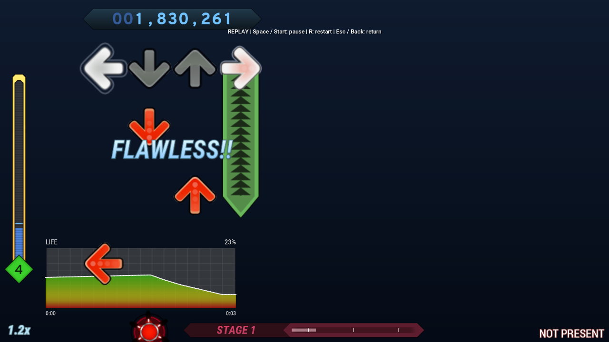

# Single-player recording and replay

This fork can record a local single-player song and play it back inside StepMania. A recording includes the actual note judgments, score/combo changes, life history, player modifiers, and live playback-speed changes. It uses the installed song's music and background/video assets; it is not a video file.



Actual replay captured on Linux from Classic (then named Default); [capture details](media/README.md#replay-screenshot).

## Record a play

1. Join as **P1 or P2**, with only one player enabled, and select a song in regular song mode.
2. Open the song options and set **Save Replays → On**. Recording is off by default. Leave Autosync, Haste, and sound effects off, and use the normal life bar.
3. Play normally. Chiikawa and Classic show **Recording replay** near the bottom-right. The existing Shift+arrow speed controls work as usual and their changes are recorded.
4. Finish the song. On evaluation, press **F10** to watch that play. Failed plays can also be replayed. Backing out saves an explicitly labeled aborted recording, available from the song-selection browser.

If recording cannot start or a file cannot be saved, Chiikawa and Classic show the reason. The same message is written to `Logs/log.txt`. On evaluation, F10 also reports why no recording is available.

Recording does not change the original play's score eligibility. In particular, adjusting speed still counts as normal gameplay. Autoplay and other existing eligibility restrictions retain their normal behavior; recording does not make such scores eligible.

## Watch a recording

On **song selection**, highlight the same song and chart and press **F10** to open its replay browser. Use Up/Down to choose a recording and Enter/Start to watch it. The browser lists newest recordings first and displays dates in **UTC**.

During replay:

| Control | Action |
| --- | --- |
| **Space** or **Start** | Pause/resume |
| **R** | Restart from the beginning |
| **Esc** or **Back** | Return to the evaluation or replay browser |
| **Enter/Start**, after completion | Return |

The replay applies the recorded speed changes automatically. Live speed adjustment and note input are disabled while watching. The end message shows the original outcome, score, and max combo. Returning restores the previous stage, player settings, calibration offset, and original evaluation.

Watching or restarting a replay does **not** save a new score, increment play counts or activity totals, award another stage, or create another recording.

## Files and compatibility

Recordings are saved as version 1 **`.smr.json`** files under **`Save/Replays/`**. Keep this directory when updating a portable installation. Files are named with a chart fingerprint, a UTC timestamp, and a collision counter. Delete unwanted recordings there while the game is closed; no automatic retention policy deletes old files.

The saved chart includes the resolved note layout, so turns and shuffles do not rerandomize when viewed. A fingerprint checks the source note data and timing before playback. The browser requires the matching installed song/chart and style; a missing music file or a mismatched chart is reported instead of starting playback. Music, videos, noteskins, and themes are reused from the installation, not embedded in the recording. Appearance can therefore differ after theme/noteskin changes.

The reader limits file size to **64 MiB**, resolved notes to **250,000**, timeline frames to **500,000**, and validates timestamps, note references, counters, and judgment types. Recording also stops with a message if its size/event/duration limits are reached. The original score-saving path remains independent if recording fails.

The previous upstream version 0 XML exports cannot be played by this implementation: they lack the needed input/rate timeline and complete hold results. Historical high scores alone cannot reconstruct a replay.

## First-version scope

Supported: local regular-song gameplay with one joined player, including P1-only and P2-only play, live speed changes, taps, jumps, holds, rolls, lifts, mines, misses, and completed/failed/aborted results. Chiikawa and Classic supply visible hints; the F10 shortcuts and replay screens are also available to themes that inherit the fallback definitions.

Not recorded in this version: courses, multiplayer/network play, editor/calibration sessions, battery/time life meters, attacks, keysound charts, Haste, or controller-driven music sound effects. Enabling calibration or attacks during a recording stops it; changing chart timing or the calibration offset prevents saving a misleading replay. Custom gameplay screen classes and song scripts with their own clocks need separate support/verification.

Replays reproduce recorded outcomes instead of scoring the inputs again. This avoids changing hold judgments or scores when the viewer runs at another frame rate or uses different judgment settings. Pauses taken in the original play do not add waiting time to the replay; the viewer has its own pause control. Seeking, editing a replay, playing against a ghost, multiplayer recording, and MP4 export are outside this version.

## Verification

With an existing Linux CMake build:

```sh
python3 src/tests/run_gameplay_rate_engine.py build/live-rate src/tests/test_replay_data.cpp
python3 src/tests/run_gameplay_rate_engine.py build/live-rate src/tests/test_replay_session.cpp
python3 src/tests/run_gameplay_rate_engine.py build/live-rate src/tests/test_gameplay_rate_engine.cpp
python3 src/tests/run_gameplay_rate_engine.py build/live-rate src/tests/test_gameplay_rate_scores.cpp
```

The data test covers original-result round trips, timing-sensitive identity, malformed files, invalid note references/hold judgments, and numeric bounds. The session test covers missing/changed assets, browser filtering, play/profile guards, restart, and early-exit restoration. The rate tests verify that existing controls and ordinary score saving still work.

For an in-game check on Windows x64, enable recording and play a short chart containing holds/rolls, a mine, and a lift. Use both speed directions and both reset chords. Note the evaluation score, judgments, combo, and life graph; press F10, pause/resume/restart, and compare the result. Return to the original evaluation, then try F10 from song selection. Repeat with P2 only and a failed or aborted play. Verify that watching adds no scores, play counts, activity, or replay files and that your preferred speed/settings return.

The implementation has been exercised with real rendered Linux gameplay in an isolated portable folder using a generated chart and WAV, including successful P1 replay, human P2 failure, pause/restart, and early return. Saved files were compared before/after viewing. The local build uses the Null audio driver and has video decoding disabled, so audible music/video synchronization and the Windows x64 runtime still need platform testing. No new Windows ZIP is published by this change alone.
