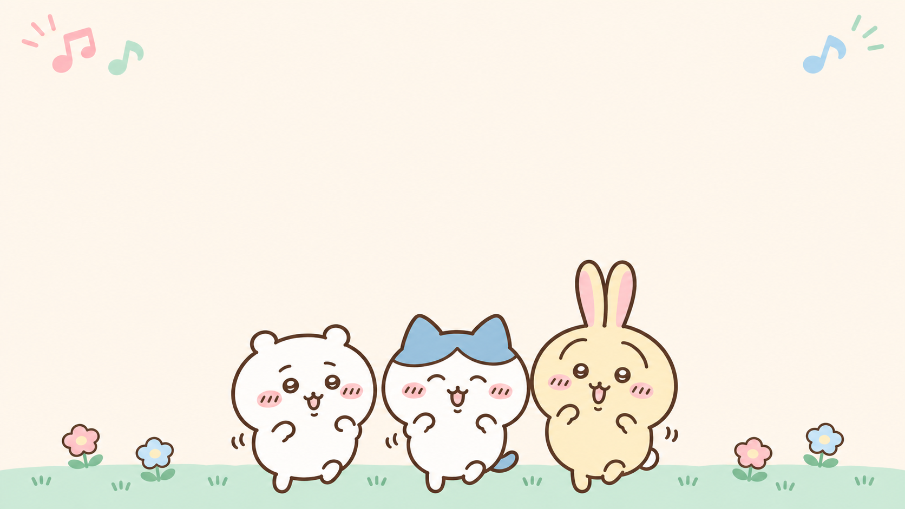
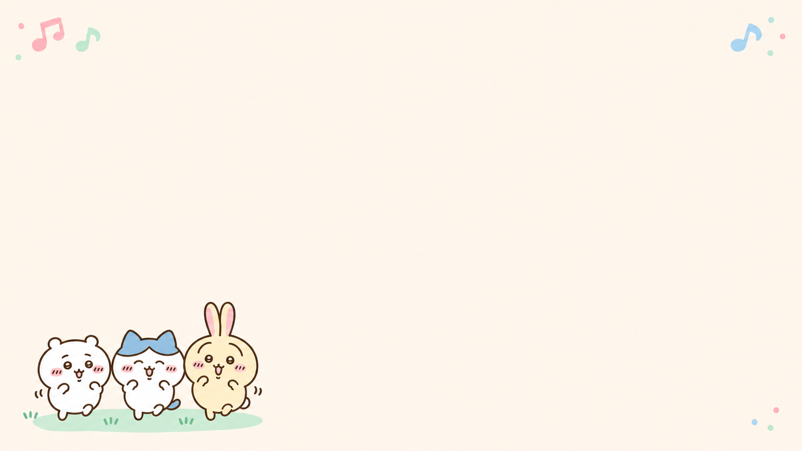

# Chiikawa artwork preview for StepMania 6

The selected direction is **recognizable Chiikawa characters with warm cream, pastel pink, mint, and sky blue**. This folder contains four AI-generated illustration previews and a plan for applying the same look across the interface.

**Open [index.html](index.html) in a browser** for the local gallery. It works without a server or network access. Switch between title, song selection, gameplay, evaluation, and replay concepts; compare 16:9 with 4:3; and inspect transparent cutouts against cream, checkerboard, or dark backgrounds. The layouts use sample data and browser fonts, and are not captures of an implemented theme.

- [Artwork and implementation plan](ARTWORK_PLAN.md)
- [Exact prompts and provenance](PROMPTS.md)
- [Image manifest](manifest.json)

| Preview | Intended use | File |
| --- | --- | --- |
| Character trio | Reusable menu/header decoration; identity reference | [01-character-trio.png](images/01-character-trio.png) |
| Title background | Title/menu backdrop with open central space | [02-title-background.png](images/02-title-background.png) |
| Selection background | Quiet backdrop with a small corner vignette | [03-selection-background.png](images/03-selection-background.png) |
| Results/replay illustration | Supportive header or empty-space decoration | [04-results-replay.png](images/04-results-replay.png) |

The raw images are in **`images/`**. The two cutouts have real alpha transparency. The title/selection backgrounds are 1672 × 941, approximately 16:9; the cutouts are 1536 × 1024. All source pixels are preserved.

The current StepMania theme is unchanged. The plan covers a separate inherited theme, shared colors/fonts/panels, gameplay clearance, evaluation and replay styling, and later Windows verification. Useful feedback is which illustrations you prefer, whether character sizes and line thickness feel right, and whether the screen compositions need more or less decoration.

## Preview checks

All four PNGs decode and match their original saved checksums. Both cutouts have real transparency and were visually inspected on cream and checkerboard. The five browser compositions were inspected at 1280 × 720 and 1024 × 768. Local links and image descriptions were checked, and the gallery JavaScript passes a syntax check.

The title characters are slightly taller than initially requested, and the selection vignette uses a dancing pose instead of the requested sitting pose. Both are accepted for preview; the exact prompt and inspection notes preserve these differences. The song-selection header placement should account for the corner musical accents. Browser fonts and schematic arrows/graphs illustrate the layout; production engine fonts, noteskins, animations, and Windows behavior still need the later implementation checks.
