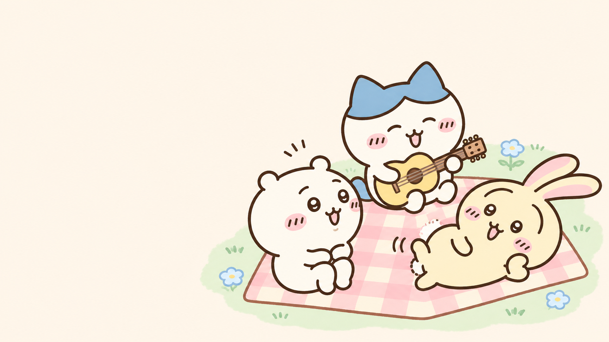

# Chiikawa artwork preview for StepMania 6

The selected direction is **recognizable Chiikawa characters with warm cream, pastel pink, mint, and sky blue**. This folder now contains **ten AI-generated illustrations**, including six new compositions, and a plan for applying the look across the interface.

**Open [index.html](index.html) in a browser** for the local gallery. It works without a server or network access. Switch between title, song selection, gameplay, evaluation, and replay concepts; compare 16:9 with 4:3; choose the character decoration; and inspect cutouts against cream, checkerboard, or dark backgrounds. The candidate filter compares the six new illustrations, the first four, or all ten.

The screen concepts now draw the **original bitmap fonts, arrow/receptor textures, and judgment artwork**. Their shapes are unchanged. Text tint and surrounding panels adopt the new palette; arrows and judgment labels retain their existing colors and shading. The browser controls outside the concepts use normal browser fonts. These are static layouts with sample data, not captures of an installed theme.

- [Artwork and implementation plan](ARTWORK_PLAN.md)
- [Exact prompts and provenance](PROMPTS.md)
- [Image manifest](manifest.json)
- [Original theme asset mappings and checksums](original-theme/README.md)

## Six new compositions

| Preview | Composition | File |
| --- | --- | --- |
| 05 · Listening | Solo Chiikawa seated with headphones; compact silhouette | [05-listening.png](images/05-listening.png) |
| 06 · Acoustic | Solo Hachiware seated with a diagonal guitar | [06-acoustic.png](images/06-acoustic.png) |
| 07 · Leap | Solo Usagi airborne in a tall diagonal pose | [07-leap.png](images/07-leap.png) |
| 08 · Picnic rehearsal | Interacting trio around a blanket; unequal heights and a triangular grouping | [08-picnic.png](images/08-picnic.png) |
| 09 · Peek | Staggered partial-body poses in a vertical strip | [09-peek.png](images/09-peek.png) |
| 10 · Rest | Chiikawa and Hachiware sleeping in a low, curved composition | [10-rest.png](images/10-rest.png) |

These variations change the cast size, activity, mood, silhouette, and arrangement while retaining the established characters and palette. The picnic is an opaque background; the other five new images have real alpha transparency.

## First four candidates

| Preview | Intended use | File |
| --- | --- | --- |
| Character trio | Reusable menu/header decoration; identity reference | [01-character-trio.png](images/01-character-trio.png) |
| Title background | Title/menu backdrop with open central space | [02-title-background.png](images/02-title-background.png) |
| Selection background | Quiet backdrop with a small corner vignette | [03-selection-background.png](images/03-selection-background.png) |
| Results/replay illustration | Supportive header or empty-space decoration | [04-results-replay.png](images/04-results-replay.png) |

The full-resolution files are in **`images/`**. Across both sets there are seven transparent cutouts and three opaque backgrounds. All generated source pixels are preserved. The exact sizes, references, and hashes are recorded in the manifest.

## Preview checks and next stage

All ten PNGs decode and match their saved hashes. All 15 copied original font/INI/sprite assets match their repository sources. The five screen concepts were rendered at 1280 × 720 and 1024 × 768 with no missing sample glyphs. Text wraps without stretching the original letterforms, and decorations clear the sample note field, life bar, speed label, lists, and result rows. Cutouts were reviewed on cream and checkerboard. Local links and JavaScript syntax were checked.

This preview does not reproduce the engine's full font fallback, animation, or rendering effects; the life graph remains a layout sketch. The current playable theme is unchanged. The plan covers later integration into a separate inherited theme and verification in Windows x64. Artwork choice and final in-game placement remain open for review.
