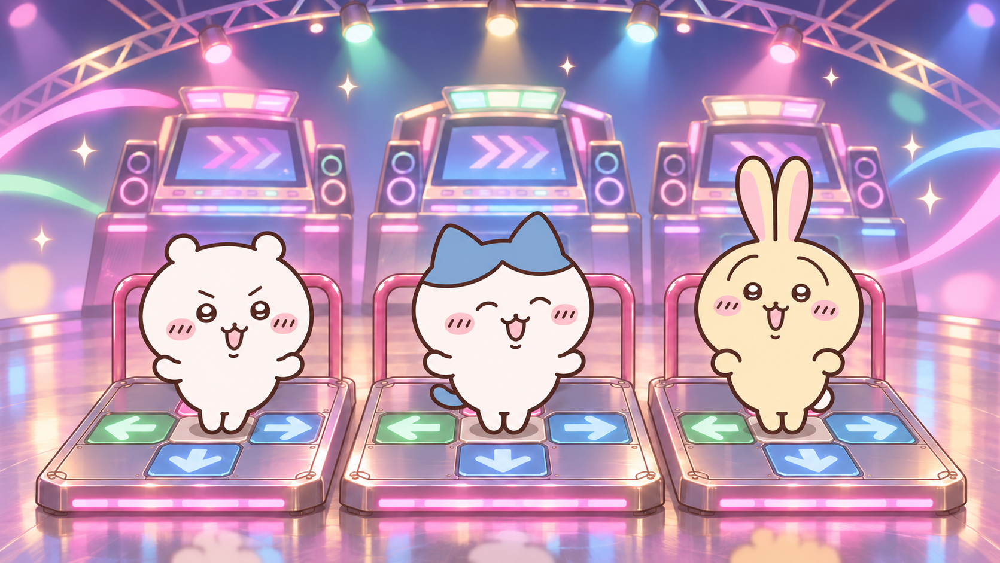

# Dancing-trio gameplay background

Status: **center-tile reference and expanded choreography ready for the next generation.** The user has generated trial movies externally and reported repetitive hopping on the up-arrow panel. The trial videos have not been supplied here for inspection, and no movie is installed in the theme yet.

This is a still keyframe edited with the built-in image generator. All three characters now have both feet on their own blank center tile in a ready stance. The characters, arcade lighting and pad arrangement are retained. It is AI-generated fan artwork, not official Chiikawa artwork. The generator output is copied without post-processing; dimensions, SHA-256 and previous-version provenance are recorded in [manifest.json](manifest.json). Exact prompts are saved for the [image edit](keyframe-v2-prompt.txt) and [movie](movie-prompt.txt).

## Use this revision

1. Replace both the start-frame and end-frame inputs with [ddr-trio-keyframe-v2.png](ddr-trio-keyframe-v2.png). Keeping the previous end frame would ask the movie to return to the old stance.
2. Replace the earlier motion instructions with the full [updated movie prompt](movie-prompt.txt). It specifies an 8-second sequence: side steps, quick runs from center across the rear/front panels, a two-foot jump onto left/right, and a complete spin ending back at center.
3. Generate at 16:9 and 720p or higher. Inspect actual foot travel across the tiles and the loop seam; the centered image and prompt guide the motion but do not guarantee it.

The center pose is the opening/closing reference. The characters should use all four arrow panels during the movie rather than repeatedly hopping on one spot. The [original keyframe](ddr-trio-keyframe.png), [original image prompt](keyframe-prompt.txt), and [original movie prompt](movie-prompt-v1.txt) remain available for comparison.

The intended movie is a short silent 16:9 loop with all three characters dancing, a smooth shallow camera orbit and push/pull movement, colorful arcade lighting, and a return to the opening framing. Original gameplay fonts, arrows and judgment graphics remain above it. The choreography is decorative; a reusable loop cannot match the steps or tempo of every song. Its playback time should still follow the song clock and live speed changes.

## Integration findings

- `src/Background.cpp`, in `BackgroundImpl::Layer::CreateBackground`, resolves the song-background marker to the song's own background when available, or `THEME:GetPathG("Common", "fallback background")` otherwise. A Chiikawa-specific fallback can therefore use theme assets without changing C++.
- The same engine accepts movies as background actors. `BackgroundEffects/StretchNormal.lua` selects the music clock, scaling/cropping, texture rate and focus play/pause commands. Integration should preserve those behaviors rather than play a movie as a menu decoration.
- Respect the engine background-brightness setting and draw the movie below notes, judgments and the life-history graph. Use a poster for `StaticBackground`/disabled song backgrounds and an explicit no-motion option if needed.
- Song images and scripted background changes must keep their normal precedence. Avoid a second random character cutout over the dancing trio when the new fallback is active. Verify centered/P2/4:3 layouts before adopting any local dimming mask.
- The current `native/gameplay.png` uses the synthetic demo chart's own dark `background.png`, declared by `#BACKGROUND:` in `demo.sm`. It is not an example of the engine's missing-image fallback. A new capture must use a genuinely background-free chart.

## Remaining validation

Inspect the next generated movie for tile travel, jumps, running, spins and a clean loop seam; export a silent movie with a codec supported by the bundled Windows decoder and a matching poster; test native no-art/own-art/scripted-video songs, pause, live rate changes, replay and both aspect ratios. Windows x64 decoder/rendering verification remains necessary. The Linux fixture's previous layout checks do not establish movie playback support.
