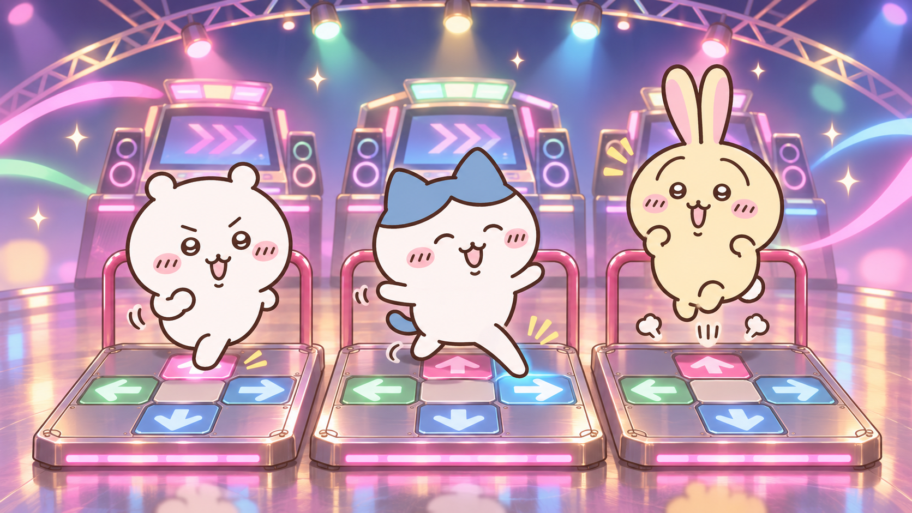

# Dancing-trio gameplay background

Status: reference artwork and implementation plan prepared. **No movie has been generated or installed.** The actual clip is awaiting a choice between a connected video-generation provider and a locally rendered illustrated animation.

This is a still keyframe generated with the built-in image generator. It sets the characters, dance pads and lighting for the movie. It is AI-generated fan artwork, not official Chiikawa artwork. The unchanged source output, dimensions and SHA-256 are recorded in [manifest.json](manifest.json). Exact prompts are saved for the [keyframe](keyframe-prompt.txt) and [movie](movie-prompt.txt).

The intended movie is a short silent 16:9 loop with all three characters dancing, a smooth shallow camera orbit and push/pull movement, colorful arcade lighting, and a return to the opening framing. Original gameplay fonts, arrows and judgment graphics remain above it. The choreography is decorative; a reusable loop cannot match the steps or tempo of every song. Its playback time should still follow the song clock and live speed changes.

## Integration findings

- `src/Background.cpp`, in `BackgroundImpl::Layer::CreateBackground`, resolves the song-background marker to the song's own background when available, or `THEME:GetPathG("Common", "fallback background")` otherwise. A Chiikawa-specific fallback can therefore use theme assets without changing C++.
- The same engine accepts movies as background actors. `BackgroundEffects/StretchNormal.lua` selects the music clock, scaling/cropping, texture rate and focus play/pause commands. Integration should preserve those behaviors rather than play a movie as a menu decoration.
- Respect the engine background-brightness setting and draw the movie below notes, judgments and the life-history graph. Use a poster for `StaticBackground`/disabled song backgrounds and an explicit no-motion option if needed.
- Song images and scripted background changes must keep their normal precedence. Avoid a second random character cutout over the dancing trio when the new fallback is active. Verify centered/P2/4:3 layouts before adopting any local dimming mask.
- The current `native/gameplay.png` uses the synthetic demo chart's own dark `background.png`, declared by `#BACKGROUND:` in `demo.sm`. It is not an example of the engine's missing-image fallback. A new capture must use a genuinely background-free chart.

## Remaining validation

Generate and inspect the actual motion and loop seam; export a silent movie with a codec supported by the bundled Windows decoder and a matching poster; test native no-art/own-art/scripted-video songs, pause, live rate changes, replay and both aspect ratios. Windows x64 decoder/rendering verification remains necessary. The Linux fixture's previous layout checks do not establish movie playback support.
