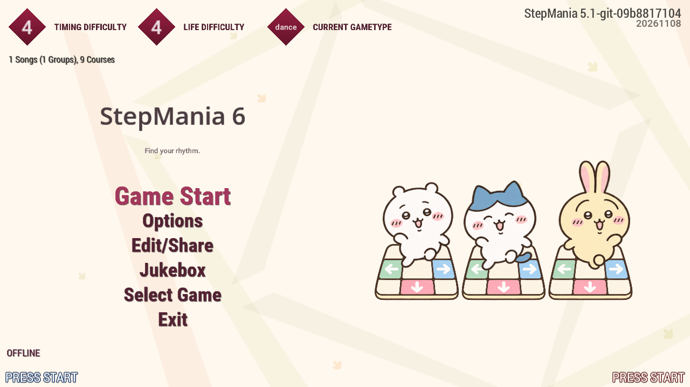
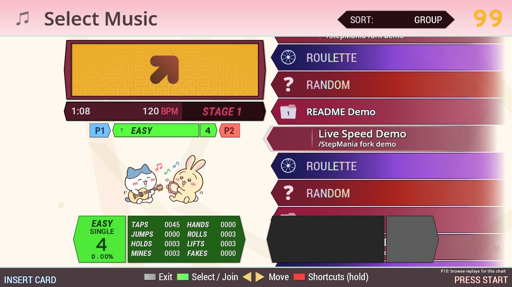
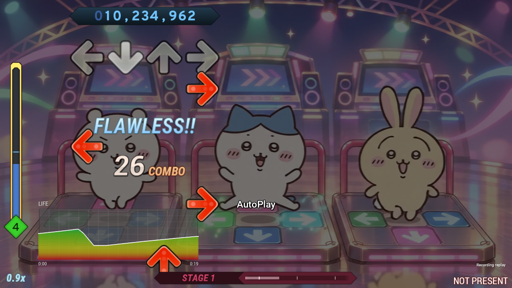
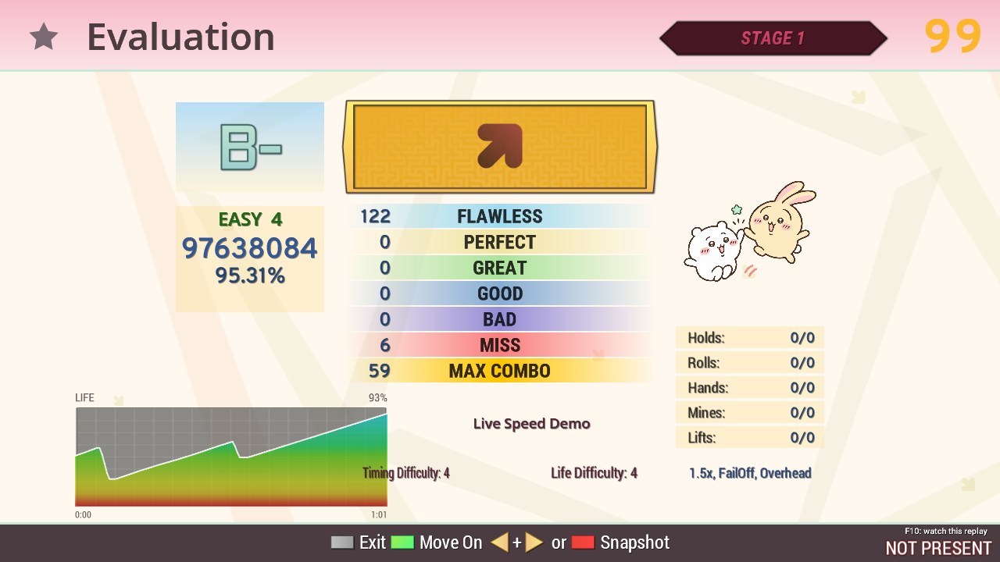
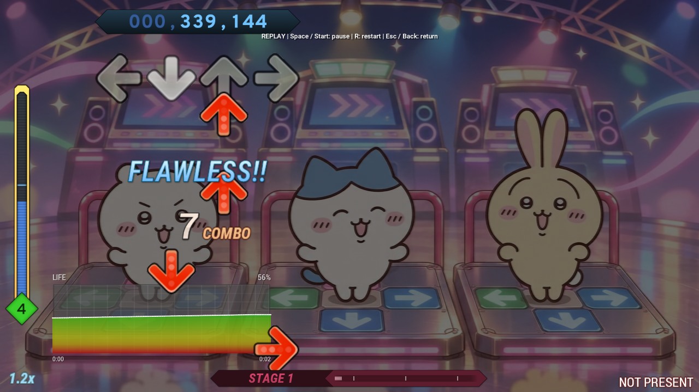
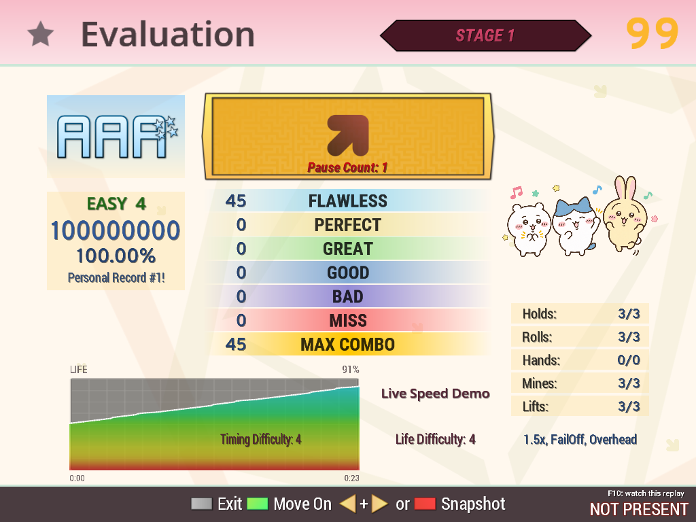
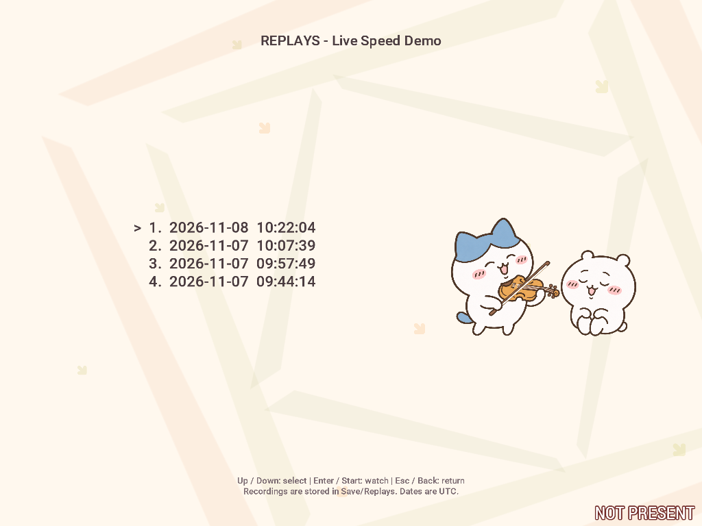

# Native Chiikawa theme captures

These are actual StepMania screens showing the [finished Chiikawa theme](../README.md). The title and movie-background gameplay images were refreshed on **2026-11-09**, alongside the repository's evaluation, replay and gameplay video captures. The other selection and 4:3 examples below were captured on 2026-11-08. All use isolated synthetic charts, software OpenGL and null audio on Linux. The inherited engine version string still identifies the existing StepMania 5.1 debug build.

The title illustration loops on the right of the original menu. [View the transparent looping GIF](../../../media/title-dance.gif) or the [4:3 native title capture](title-4x3.png). **Fancy UI Background → Off** freezes the dancers in a neutral pose. The 4:3 capture is from the title-animation verification on 2026-11-08.

Gameplay uses the **silent dancing background movie**, with 45% background brightness and a background-free synthetic chart. This image shows 0.9x playback after a brief autoplay interruption produces a visible life-history dip. [Watch the 40-second control demonstration](../../../media/live-speed-demo.mp4) or [the full 30-second background movie](../../../../Themes/chiikawa/Movies/ddr-trio-loop.mp4).

The new 16:9 evaluation and replay images come from the same recorded play. [Capture setup, provenance and media hashes](../../../media/README.md).

The PNGs are unedited native captures. Random decorations differ on later visits outside the title menu. Original functional panels, fonts, arrows and judgments remain inherited. Windows x64, physical controller input and audible synchronization are not verified by these Linux captures.

[Install and customize the theme](../../../../Themes/chiikawa/README.md). Detailed native fixtures and logs remain under ignored `out/chiikawa-native/`, `out/chiikawa-pane-fix/`, `out/chiikawa-movie/`, `out/title-dance/` and `out/readme-chiikawa/` in the development workspaces. Original artwork, movie clips, prompts and assembly tools remain on the [development branch](../../../ChiikawaDevelopment.md).
