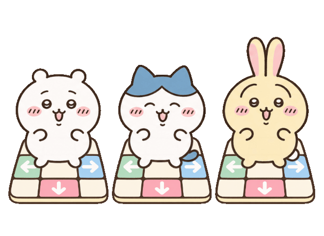

# Transparent title-menu dance loop

Chiikawa, Hachiware and Usagi dance on three pastel cartoon DDR pads on the **right of the Game Start / Options title menu**. This feature revision lives only on `feature/chiikawa-theme`.



[Open the interactive preview](preview.html) for play/pause and cream, checkerboard or dark backgrounds. [See the actual 16:9 title menu](../native/title.png) or [the 4:3 capture](title-4x3.png). The screenshots are unedited engine captures; the GIF and interactive preview show the isolated illustration.

## Native behavior

The 3.2-second loop uses four AI-drawn poses per character: left step, neutral, right step and hop. Lua adds smooth side steps, hops and small turns with staggered timing. The pads stay fixed, and the feet return to their blank center tiles. This is an illustrated sprite animation, not a generated video. The characters and pads have transparent backgrounds, so the cream menu and its moving layers remain visible around them.

The native GIF loader reads only the first image. The theme therefore uses [a PNG sprite sheet](../../../../Themes/chiikawa/Art/title-dancers%204x3.png), [a separate pad layer](../../../../Themes/chiikawa/Art/title-dance-pads.png), and [TitleDance.lua](../../../../Themes/chiikawa/Scripts/07%20TitleDance.lua). PNG retains smooth alpha; the downloadable GIF has palette transparency and 96 frames at nominal 30 fps, totaling 3.2 seconds. GIF frame delays alternate between 30 and 40 ms because the format uses hundredths of a second.

**Options → Theme Options → Fancy UI Background → Off** freezes the title trio in a neutral pose and stops the menu background motion. Returning to the title menu restarts the loop when enabled. Other decorated screens keep their existing random pools. Original menu text, fonts and controls are inherited. Copy the updated `Themes/chiikawa/` into an existing installation; the title animation requires no executable rebuild.

## Artwork and reproducibility

The built-in image generator produced both source images. The reference is the existing [character trio](../images/01-character-trio.png). Both original outputs are preserved unchanged.

| Source | Exact generation prompt | Runtime use |
| --- | --- | --- |
| [Twelve character poses](characters-source.png) | [Character prompt](characters-prompt.txt) | Losslessly packed into twelve 416×416 cells |
| [Three cartoon pads](pads-source.png) | [Pad prompt](pads-prompt.txt) | Copied unchanged as a stationary layer |

[manifest.json](manifest.json) records source identifiers, hashes, dimensions and alpha, plus the exact source crops and placements from [packing.json](packing.json). Packing preserves the source pixels, including alpha. These are AI-generated fan illustrations, not official Chiikawa artwork.

From the repository root:

```sh
python3 Docs/theme-preview/chiikawa/title-dance/build-assets.py
node Docs/theme-preview/chiikawa/title-dance/build-preview.mjs /path/to/bundled/lua
```

Packing requires Python, Pillow and FFmpeg. Preview export requires Node.js 22 or later, FFmpeg, the bundled Lua interpreter and Chrome (`TITLE_DANCE_CHROME` can override its path). It exports the actual Lua motion to [motion-data.js](motion-data.js), renders it in a transparent canvas, checks the rendered loop endpoint, and encodes the GIF. Open `preview.html` locally after export; no server or network is required. Intermediate frames stay under ignored `out/title-dance/browser/`.

## Verification

Focused Lua checks cover all character poses, periodic motion, section/loop boundaries, RNG isolation, stationary pads, 16:9/4:3 sizing, motion off and return-to-title lifecycle. Existing theme-selection checks also pass.

Native Linux verification covers both aspect ratios, moving and frozen dancers, Options and return, and Game Start navigation. The frozen illustration region is pixel-identical across captures 1.5 seconds apart; moving captures differ. The exported GIF's decoded alpha mask matches the corresponding rendered PNG at every frame, with no trails. The rendered start and wraparound frames are identical. See [preview-manifest.json](preview-manifest.json) for preview hashes and [verification.json](verification.json) for recorded evidence.

Native captures use the existing Linux debug executable, software OpenGL and null audio in an isolated fixture. Windows x64 rendering has not been checked for this revision. Detailed native logs and intermediate captures remain under ignored `out/title-dance/`. No executable rebuild, Windows ZIP, main-branch commit or remote push is part of this change.
