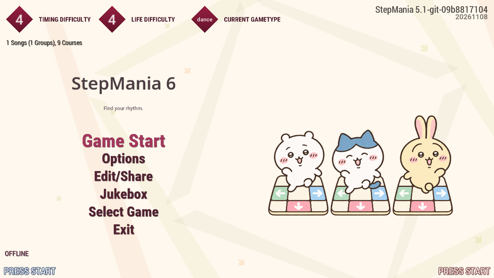

# StepMania 6

[](https://github.com/chihduo/stepmania/actions/workflows/ci.yml)

StepMania 6 is a rhythm game for playing and practicing dance charts with a keyboard or dance pad. Press the matching direction as each scrolling arrow reaches the target row. This independent community fork of [StepMania 5.1](https://github.com/stepmania/stepmania) adds live playback-speed controls, single-player recording and replay, and a life-history graph.

The default **Chiikawa** interface has cream and pastel menus, character illustrations, and an animated title screen.

[Download for Windows x64](#install-on-windows-x64) · [Playback controls](#playback-controls) · [Record and replay](#record-and-replay) · [Build from source](#build-from-source)



## Features

- **Adjust the tempo while playing.** Slow down a difficult passage or speed up a familiar chart while notes, music, and standard song videos stay synchronized.
- **Record and review a performance.** Watch single-player recordings with their original judgments, score, combo, life history, and speed changes.
- **Track your life meter.** Follow the live graph during a song and inspect the complete history on the results screen.
- **Browse without losing your place.** Changing the song-selection sort keeps the highlighted song selected when it is available in the new sort.

## Install on Windows x64

1. Open [Windows portable builds](https://github.com/chihduo/stepmania/actions/workflows/ci.yml?query=branch%3Amain) and select a successful **main** run with a downloadable artifact.
2. Download **StepMania-windows-x64-\<run\>.\<attempt\>** from its **Artifacts** section. GitHub may require you to sign in.
3. Extract the download, then extract the `StepMania-6.0-windows-x64-portable.zip` inside it. A `.sha256` checksum file is included.
4. Launch **`StepMania/Program/StepMania.exe`**. Keep the entire extracted folder together, including `Portable.ini`, which keeps settings and profiles inside this installation.
5. Add song packs under **`StepMania/Songs/`**, using the structure `Songs/<pack>/<song>/`. Restart the game after adding songs.
6. Open **Options** to configure your keyboard or dance pad, then choose **Game Start**, a song, and a difficulty.

Each build corresponds to the commit shown on its workflow run. Download artifacts are retained for 30 days. If none are available, use the [source-build instructions](#build-from-source); repository maintainers can also start a build with **Run workflow**.

## Playback controls

During a song, hold either **Shift** key and press an arrow:

| Shortcut | Action |
| --- | --- |
| **Shift + Up** or **Shift + Right** | Increase speed by **0.1x** |
| **Shift + Down** or **Shift + Left** | Decrease speed by **0.1x** |
| **Shift + Up + Down** or **Shift + Left + Right** | Reset speed to **1.0x** |

The range is **0.2x–3.0x**. Each new press adjusts speed once; holding a key does not repeat it. The latest speed remains at the bottom-left after the first adjustment. Notes, music, and standard song videos follow the same song clock.

Changes affect the **current play only**. Your original settings return when the play ends or restarts. Plays with adjusted speed follow the usual scoring, saving, and eligibility rules. Arrows used with Shift adjust speed without triggering notes, and ordinary arrows remain note inputs.


[Watch the 40-second gameplay video](Docs/media/live-speed-demo.mp4). These controls apply during active local gameplay. See the [playback guide](Docs/LiveGameplayRate.md) for supported modes, scrolling modifiers, and details about custom song scripts.

On **song selection**, press **Left + Right** to cycle the available sort orders while keeping your highlighted song selected.

## Record and replay

To record a regular single-player song, set **Save Replays → On** in song options, then play normally. Recording is off by default and supports either P1 or P2, with only one player joined. The **Recording replay** message confirms that a recording is underway.

- On the **results screen**, press **F10** to watch the play you just recorded.
- On **song selection**, highlight the same song and chart, then press **F10** to browse recordings. Use Up/Down to choose one and Enter/Start to watch.

During playback:

| Control | Action |
| --- | --- |
| **Space** or **Start** | Pause or resume |
| **R** | Restart from the beginning |
| **Esc** or **Back** | Return to results or the replay browser |

The replay applies recorded judgments and speed changes automatically. Watching it does not add scores or play counts. Completed and failed plays can be watched from the results screen. Aborted recordings are available in the song-selection browser.


Recordings are stored in **`Save/Replays/`** and require the matching installed song, chart, and media. They replay inside the game using those installed assets. Courses, multiplayer, attacks, keysound charts, and calibration are outside the supported recording modes. See the [recording and replay guide](Docs/SinglePlayerReplays.md) for the full requirements and file details.

## Review your performance

The **life-history graph** appears at the bottom-left during single-player gameplay and on the results screen. It updates as life changes and keeps the entire elapsed play in view, showing where life dropped or recovered. Its time axis follows elapsed play time even when you adjust speed.


The graph supports P1-only and P2-only play. See the [life-history guide](Docs/LifeHistoryGraph.md) for layout settings and supported modes.

## Appearance and backgrounds

Songs use their own background images and videos. When no background artwork is available, a silent dancing-trio movie supplies the background; **Static Background** uses its still poster. Backgrounds play beneath the notes and gameplay information.

Use **Options → Theme Options → Fancy UI Background** to enable or disable title and menu motion. For artwork, colors, layout, and other appearance settings, see the [Chiikawa customization guide](Themes/chiikawa/README.md).

## Update a portable installation

Close the game and back up your installation. Extract the new package into a separate folder, then copy **`Program/`**, **`Scripts/`**, **`Themes/`**, and **`BackgroundEffects/`** into your existing game folder, replacing matching files. Also copy **`Data/Defaults.ini`**. Updating **`Docs/`** is optional.

Keep **`Save/`**, **`Songs/`**, **`Screenshots/`**, **`Logs/`**, and **`Portable.ini`**, along with any other personal content. `Save/` holds settings, profiles, play history, and recordings. Back up custom theme or script edits before replacing files. Archive any logs you want to retain, since normal startup rewrites the standard log files.

## Build from source

```sh
git clone --branch main https://github.com/chihduo/stepmania.git
cd stepmania
```

On Windows, install Visual Studio 2022 with C++ tools, CMake, Git, and PowerShell 7, then run:

```powershell
pwsh -File ci/Invoke-WindowsPortablePipeline.ps1
```

The pipeline builds an x64 Release executable, checks the portable layout and startup, and writes the ZIP and checksum to `out/`. See the [Windows build guide](Docs/WindowsPortablePipeline.md) for details. For Linux and macOS source builds, see the [CMake guide](Build/README.md) and [build/install notes](Build/INSTALL.md).

## Documentation and credits

- [Live playback controls](Docs/LiveGameplayRate.md)
- [Single-player recording and replay](Docs/SinglePlayerReplays.md)
- [Life-history graph](Docs/LifeHistoryGraph.md)
- [Appearance and customization](Themes/chiikawa/README.md)
- [Screenshots, videos, and capture details](Docs/media/README.md)
- [Development progress and verification](PROGRESS.md)

StepMania 6 builds on the work of the StepMania team, the sm-ssc contributors, and the theme and noteskin authors. Chiikawa illustrations and movies are AI-generated fan artwork. Theme development sources are maintained separately; see the [branch workflow](Docs/ChiikawaDevelopment.md).

See the [project license notices](Docs/Licenses.txt) and [third-party notices](Docs/license-ext). Included songs and libraries retain their respective licensing terms.
