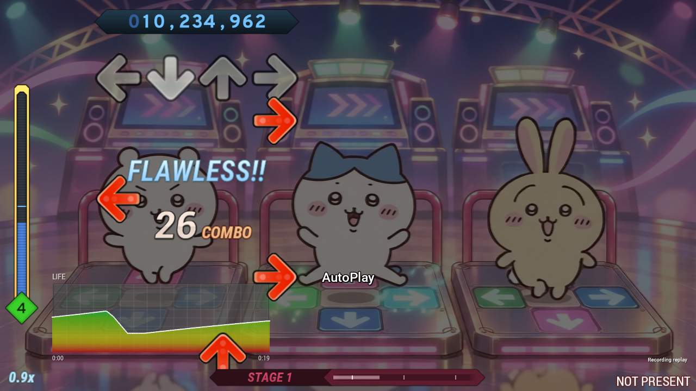
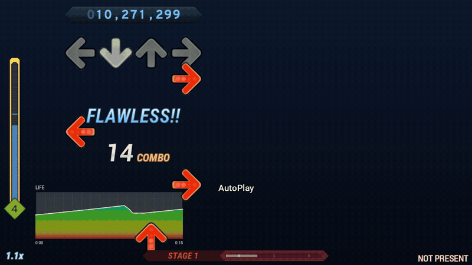
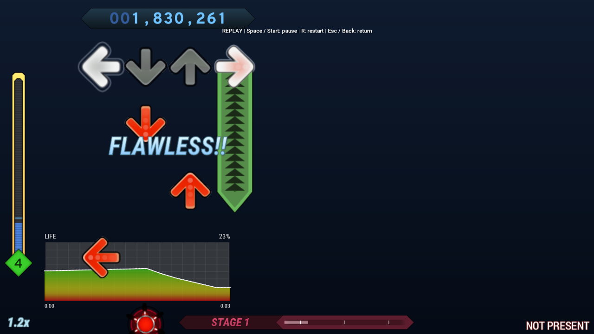
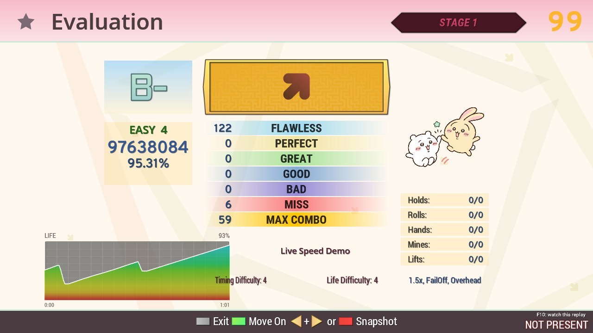

# StepMania with live speed control and single-player replays

A fork of [StepMania 5.1](https://github.com/stepmania/stepmania) for adjusting a song's speed while you play, with synchronized notes, music, and standard song videos. It also records and replays single-player songs, adds a live life-history graph to the default theme, and keeps your highlighted song selected when changing the song-wheel sort.

[](https://github.com/chihduo/stepmania/actions/workflows/ci.yml)

[Get the Windows portable build](https://github.com/chihduo/stepmania/actions/workflows/ci.yml?query=branch%3A5_1-new) · [Playback controls](Docs/LiveGameplayRate.md) · [Recording and replay](Docs/SinglePlayerReplays.md) · [Life-history graph](Docs/LifeHistoryGraph.md)



Actual gameplay captured from this fork's default theme on Linux. The generated demo chart uses autoplay with brief misses to make the life-history curve visible. [Capture details](Docs/media/README.md).

## What this fork adds

### Change playback speed during a song

Hold either **Shift** key and press an arrow:

| Shortcut | Action |
| --- | --- |
| **Shift + Up** or **Shift + Right** | Increase playback speed by **0.1x** |
| **Shift + Down** or **Shift + Left** | Decrease playback speed by **0.1x** |
| **Shift + Up + Down** or **Shift + Left + Right** | Reset playback speed to **1.0x** |

For example, Up, Down, Down while holding Shift changes **1.0x → 1.1x → 1.0x → 0.9x**. The supported range is **0.2x–3.0x**. Each new press changes speed once; holding a key does not repeat it. A reset takes effect when the second opposite arrow is pressed, in either order.

- Notes, music, and standard song videos follow the same song clock. Visible note movement also follows the change with XMod, CMod, and MMod.
- The latest speed stays at the **bottom-left** after the first adjustment, using the theme's FLAWLESS-style color, font, and glow.
- Changes apply to the **current song only**. The original settings return on completion, failure, cancellation, retry, or advancing to another song in a course.
- Ordinary arrows remain note inputs. Arrows used in a Shift shortcut are consumed until released, so tuning speed does not also hit a note.
- Speed-adjusted plays use **normal scoring and saving rules**, including after a reset to 1.0x. A speed change alone does not disqualify a play or suppress high scores, awards, configured replay saving, or exports. Usual save settings and other eligibility rules, such as autoplay, still apply.



[Open the 52-second silent gameplay video (MP4)](Docs/media/live-speed-demo.mp4), including both reset chords.

These controls work during active local gameplay. They are disabled while paused and in the editor, attract-mode demonstration screens, calibration, and network play. Custom song scripts that use their own real-time clocks need separate verification. Supported single-player replays include the live rate-change timeline. See [the playback guide](Docs/LiveGameplayRate.md) for behavior and verification steps.

### Record and replay a single-player song

Set **Save Replays → On** in song options to record a regular single-player play, including its speed changes, original judgments, score/combo, and life history. Recording is off by default.

- On **evaluation**, press **F10** to watch that play.
- On **song selection**, press **F10** to browse recordings for the selected chart.
- While watching, use **Space/Start** to pause/resume, **R** to restart, and **Esc/Back** to return.
- Watching restores the original results without adding another score or play to your history. The original play keeps its normal scoring rules.
- Recordings live in **`Save/Replays/`** and require the matching installed song/chart. P1-only and P2-only play are supported. Courses, multiplayer, attacks, keysounds, and calibration are outside this first version.



See [the recording and replay guide](Docs/SinglePlayerReplays.md) for requirements, file limits, and verification. This is in-game playback; it does not export an MP4.

### See life history during and after play

The **default theme** shows a life-history graph automatically for single-player gameplay, evaluation, and evaluation summary.

- It updates as life changes and keeps the whole elapsed play history in view.
- It sits at the **bottom-left**, clear of the life bar, and draws **beneath notes, judgments, and other gameplay information**.
- Its backing and colored fill are translucent; the white line and labels use **80% opacity**.
- Its time axis follows elapsed play time, so changing speed does not stretch or rewind earlier history.
- It supports P1-only and P2-only play. Two-player play, demonstration screens, and endless courses omit the graph.



Graph size, margins, and appearance can be adjusted through theme Lua and `metrics.ini` files without rebuilding the executable. See [the life-history guide](Docs/LifeHistoryGraph.md) for settings and verification steps.

### Keep the same song when changing sort

On the song-selection screen, **Left + Right** cycles the configured sort order. This fork fixes a timing issue where switching to Artist or another sort could move the selection to a neighboring song. The highlighted song is now preserved when it is available in the new sort, including when the two arrow presses land in different frames.

### Download a Windows x64 portable build

The fork includes a GitHub Actions pipeline that builds a **Windows x64 Release** package with the static C/C++ runtime. Each package is checked for its portable layout and x64 executable, then runs a startup test before being archived with a SHA-256 checksum. These automated checks do not replace in-game audio, video, and input verification.

## Install on Windows x64

1. Open [Windows portable build and test](https://github.com/chihduo/stepmania/actions/workflows/ci.yml?query=branch%3A5_1-new) and select the latest successful run for **`5_1-new`** that contains an artifact.
2. Download **`StepMania-windows-x64-<run>.<attempt>`** from the run's **Artifacts** section. GitHub may require you to sign in. Artifacts are retained for 30 days; if none remain, a repository maintainer can start a new run with **Run workflow**.
3. Extract the downloaded artifact. It contains `StepMania-5.1-windows-x64-portable.zip` and its `.sha256` file. Extract that inner ZIP as well.
4. Launch **`StepMania/Program/StepMania.exe`**. Keep the full folder together, including `Portable.ini`, which stores profiles and settings inside this portable installation.
5. Add song packs under `StepMania/Songs/`, keeping the usual `Songs/<pack>/<song>/` structure. Select the **default** theme to see the life-history graph.

### Update an existing portable installation

Close StepMania and back up the existing folder. Extract the new package elsewhere, then merge **`Program`**, **`Scripts`**, and **`Themes`** into the existing game folder, replacing matching files. Updating **`Docs`** is optional.

Keep **`Save`**, **`Songs`**, **`Logs`**, **`Screenshots`**, and **`Portable.ini`**, along with any other personal content. `Save` contains settings, profiles, play history, and recordings in `Save/Replays/`. Back up custom theme/script edits before replacing matching files. Copy historical logs elsewhere before launching, since normal startup rewrites the standard log files.

## Build from source

Clone this fork's feature branch:

```sh
git clone --branch 5_1-new https://github.com/chihduo/stepmania.git
cd stepmania
```

On Windows with Visual Studio 2022 C++ tools, CMake, Git, and PowerShell 7 installed, use the same pipeline as CI:

```powershell
pwsh -File ci/Invoke-WindowsPortablePipeline.ps1
```

The portable ZIP and checksum appear in `out/`. See [the Windows pipeline guide](Docs/WindowsPortablePipeline.md) for build and test details. The project also retains StepMania's Linux and macOS source-build support; see the [CMake guide](Build/README.md) and [build/install notes](Build/INSTALL.md).

## Documentation and credits

- [Live playback controls and regression checks](Docs/LiveGameplayRate.md)
- [Single-player recording, replay controls, and checks](Docs/SinglePlayerReplays.md)
- [Life-history layout, customization, and checks](Docs/LifeHistoryGraph.md)
- [Windows portable build pipeline](Docs/WindowsPortablePipeline.md)
- [Demo media and capture details](Docs/media/README.md)
- [Revision progress and validation records](PROGRESS.md)

This is a community fork of [StepMania](https://github.com/stepmania/stepmania), built on the work of the StepMania team, the sm-ssc contributors, and the original theme and noteskin authors. Their credits and notices remain part of the project.

See [the license notices](Docs/Licenses.txt) and [third-party notices](Docs/license-ext) for licensing details. Included songs retain their original non-commercial licensing; codec libraries such as MAD and FFmpeg have separate licensing terms.
